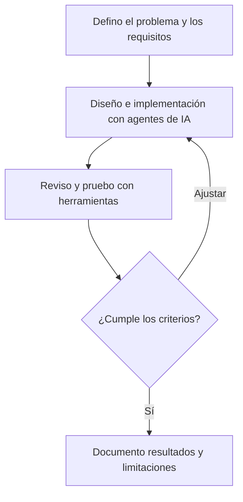

<h1 align="center">Santiago Vicente Scacciaferro Wyss</h1>

  <strong>Software · Backend · IA aplicada</strong> 
  Estudiante de Ingeniería en Sistemas — UTN FRRe · 4.º año

Busco mi primera oportunidad IT como trainee o junior.

  
  

---

### Proyectos seleccionados

| Proyecto | Qué estoy construyendo | Tecnologías |
|---|---|---|
| [**RAG Corp**](https://github.com/SaintWyss/rag-corp-showcase) | Consulta de documentos con fuentes y separación entre organizaciones. | Python · FastAPI · Next.js · pgvector |
| [**Wyss Console**](https://github.com/SaintWyss/wyss-console) | Entorno Linux con terminales persistentes y herramientas de agentes. | Rust · Tauri · Svelte · SQLite |
| [**Güemes**](https://github.com/SaintWyss/guemes-app) | Registro de entrenamientos offline y sincronización entre dispositivos. | React · TypeScript · FastAPI · IndexedDB |

Proyectos personales en desarrollo · El alcance de validación varía entre proyectos

### Código para explorar

| Repositorio público | Qué vas a encontrar |
|---|---|
| [**Notion File Uploader ↗**](https://github.com/SaintWyss/Notion-File-Uploader) | Sincronización de archivos locales con Notion. |
| [**Bienal del Chaco 2024 ↗**](https://github.com/SaintWyss/Bienal-del-Chaco-2024) | Proyecto académico Full Stack: catálogo, administración y votación. |

Bienal fue mi primer Full Stack, desarrollado sin IA en su etapa original.

---

### Cómo trabajo

Desarrollo principalmente con agentes de IA. Mi participación abarca requisitos, dirección del desarrollo, revisión y pruebas.

---

### Tecnologías en mis proyectos

  
  
  
  
  
  

Mi experiencia y participación varían según la tecnología y el proyecto.

---

### Investigación y docencia

| Espacio | Participación |
|---|---|
| **CINAPTIC** | Investigación aplicada en ciberseguridad. |
| **GIESIN · CoNaIISI 2025** | IA aplicada a educación técnica; coautor de un trabajo reconocido. |
| **UTN FRRe** | Ayudantía en Algoritmos y Estructuras de Datos. |

<strong>Me interesa construir, comprender y comprobar.</strong>

