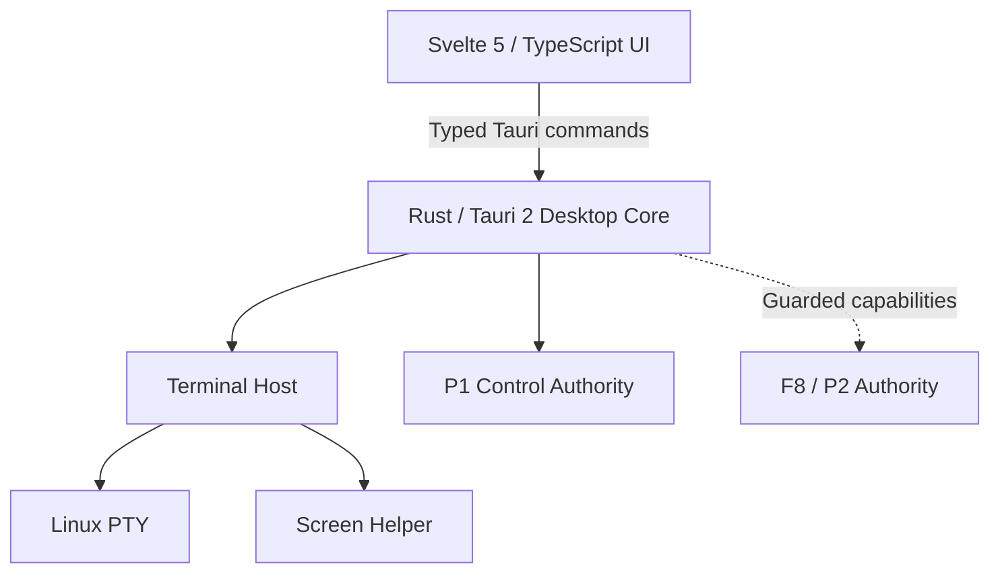
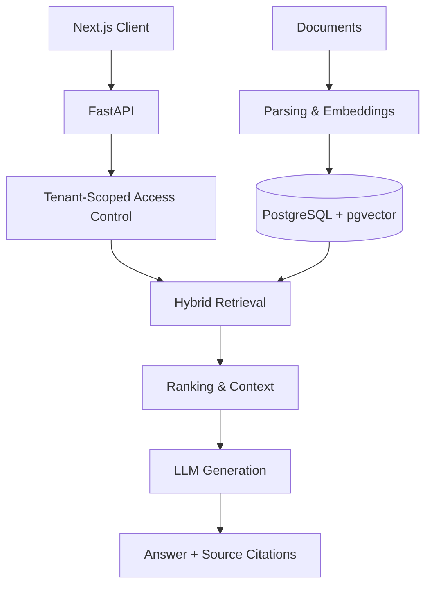
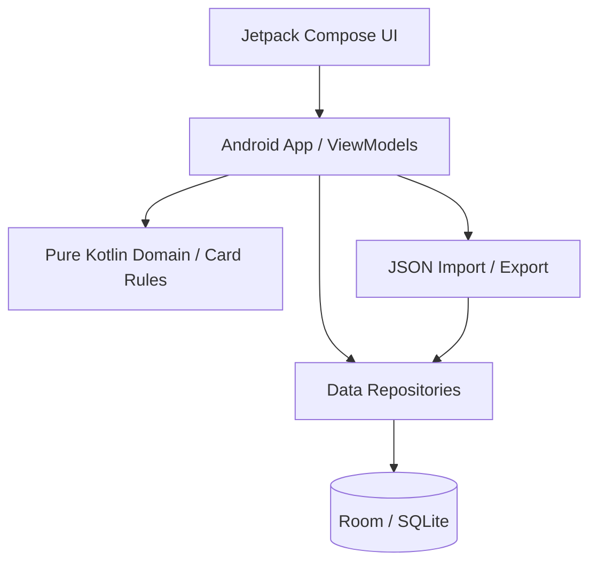

<h1 align="left">Santiago Vicente Scacciaferro Wyss</h1>

<h3 align="left">
  Software Developer · Backend Engineering · Applied AI · Cybersecurity
</h3>

  <i>“Building reliable software through thoughtful architecture, secure design, and intelligent automation.”</i>

  
  

  
  
  
  

---

<table>
<tr>
<td width="62%" valign="top">

<h2>🧠 About Me</h2>

  I'm a <b>fourth-year Information Systems Engineering student</b>
  at <b>Universidad Tecnológica Nacional (UTN FRRe), Argentina</b>
  and currently a <b>Cybersecurity Fellow</b>.

  I develop software across <b>backend systems, applied AI,
  desktop applications, and embedded systems</b>,
  with an emphasis on architecture, security, and maintainability.

  I work primarily in <b>Linux-based environments</b>,
  using Bash, Git, SSH, Docker, and terminal-driven workflows
  for development, testing, and automation.

  <b>⚙️ Backend Engineering</b> 
  REST APIs, database design, authentication,
  authorization, and service development.

  <b>🧠 Applied AI &amp; RAG</b> 
  LLM integration, retrieval pipelines, hybrid search,
  AI agents, and evaluation.

  <b>🧱 Software Architecture &amp; Quality</b> 
  Clean/Hexagonal Architecture, SOLID, GRASP,
  automated testing, and observability.

  <b>🛡️ Cybersecurity</b> 
  Application security, access control,
  security testing, and defensive engineering.

  I also contribute to <b>academic research in applied AI</b>
  and serve as a <b>Teaching Assistant in Algorithms
  and Data Structures</b>.

</td>
<td width="38%" valign="top">

<h2>🧰 Tech Stack &amp; Tools</h2>

  
  
  
  
  
  
  
  

  <b>🐧 Linux & Development Environment</b> 
  Linux · Bash · SSH · Git · Docker · CLI Tools

  <b>⚙️ Backend Development</b> 
  Python · FastAPI · REST APIs · SQLAlchemy · Alembic · OpenAPI

  <b>🗄️ Databases &amp; Storage</b> 
  PostgreSQL · pgvector · Redis · SQLite

  <b>💻 Frontend &amp; Desktop</b> 
  TypeScript · React · Next.js · Svelte · Rust · Tauri

  <b>🧠 AI Engineering</b> 
  Retrieval-Augmented Generation (RAG) · LLM Integration · Embeddings · Hybrid Search · AI Agents

  <b>🚀 DevOps &amp; Infrastructure</b> 
  Docker · GitHub Actions · CI/CD · Linux · Git

  <b>🛡️ Security &amp; Quality</b> 
  Authentication &amp; Authorization · RBAC · Automated Testing · API Security · Security Auditing

</td>
</tr>
</table>

---

<h2>🚀 Featured Engineering Projects</h2>

<table>
<tr>
<td valign="top">

<h3><a href="https://github.com/SaintWyss/wyss-console">Wyss Console</a></h3>

<b>Native Linux Development Workspace</b> · Public · In Development

  A desktop environment for developer workflows, bringing together
  <b>persistent terminals, AI-agent tools, and provider configuration</b>
  in a native Linux application.

<b>Stack:</b> Rust · Tauri 2 · Svelte 5 · TypeScript · Linux

<ul>
  <li><b>Desktop engineering:</b> Native application architecture with a Svelte frontend and Rust/Tauri backend.</li>
  <li><b>Developer tooling:</b> Terminal-oriented workflows, agent integrations, and provider management.</li>
  <li><b>Quality &amp; security:</b> Permission-aware desktop APIs, engineering documentation, and automated checks.</li>
</ul>

Actively developed; acceptance on installed Linux systems is ongoing.

<a href="https://github.com/SaintWyss/wyss-console"><b>View source code →</b></a>

</td>
</tr>
</table>

<h4>Architecture at a Glance</h4>

<table>
<tr>
<td valign="top">

<h3>RAG Corp</h3>

<b>Multi-Tenant Retrieval-Augmented Generation Platform</b> · Private · In Development

  An enterprise-oriented knowledge platform for <b>document ingestion,
  hybrid retrieval, and AI-generated answers grounded in source documents</b>,
  with tenant-aware access boundaries and evaluation tooling.

<b>Stack:</b> Python · FastAPI · Next.js · TypeScript · PostgreSQL · pgvector · Redis · Docker

<ul>
  <li><b>RAG &amp; data:</b> Embeddings, vector retrieval, hybrid search, reranking, and source citations.</li>
  <li><b>Architecture &amp; security:</b> Domain/application/infrastructure boundaries, dependency injection, authentication, and authorization.</li>
  <li><b>Quality &amp; platform:</b> Offline retrieval metrics (MRR, Recall@k, NDCG@k), OpenAPI/Orval contracts, CI, and observability tooling.</li>
</ul>

Private source code. Full end-to-end and external deployment validation is still environment-dependent.

</td>
</tr>
</table>

<h4>Architecture at a Glance</h4>

<table>
<tr>
<td valign="top">

<h3><a href="https://github.com/SaintWyss/sobremesa-apk">Sobremesa</a></h3>

<b>Offline-First Android Card &amp; Party Game</b> · Public APK · Private Source

  A native Android game for conversation cards, group activities, and karaoke,
  with <b>custom decks, persistent sessions, and offline gameplay</b>.

<b>Stack:</b> Kotlin · Jetpack Compose · Room · Hilt · kotlinx.serialization · Gradle

<ul>
  <li><b>Android development:</b> Declarative UI with Jetpack Compose and local persistence using Room.</li>
  <li><b>Modular design:</b> Pure Kotlin domain module separated from the Android application module.</li>
  <li><b>Product features:</b> Deck creation, weighted card selection, session history, and JSON import/export.</li>
</ul>

  <a href="https://github.com/SaintWyss/sobremesa-apk"><b>Project showcase →</b></a>
  &nbsp;·&nbsp;
  <a href="https://github.com/SaintWyss/sobremesa-apk/releases/tag/v1.0-karaoke"><b>Download Android APK →</b></a>

</td>
</tr>
</table>

<h4>Architecture at a Glance</h4>

<h2>🧩 More Projects</h2>

| Project | Focus &amp; Technologies |
|---|---|
| [Wyss](https://github.com/SaintWyss/Wyss) | Human-supervised AI assistant · Python, React, SQLite, RAG, automation policies |
| [Güemes](https://github.com/SaintWyss/guemes-app) | Workout tracking and progression · React, TypeScript, FastAPI, PostgreSQL · Private source, public showcase |
| [ESP32 Smart Light Panel](https://github.com/SaintWyss/esp32-smart-light-panel) | Touchscreen smart lighting controller · C++17, ESP32-S3, LVGL, Tuya LAN |
| [Notion File Uploader](https://github.com/SaintWyss/Notion-File-Uploader) | Local file metadata synchronization · Python, Notion API, Docker, Clean Architecture |
| [Borjes](https://github.com/SaintWyss/Borjes) | 3D Linux filesystem navigation · Rust, Bevy, KDE/X11 |
| [Sarmiento](https://github.com/SaintWyss/Sarmiento) | Remote device management · FastAPI, PostgreSQL, Tauri, RustDesk · Hardware acceptance pending |
| [Pellegrini](https://github.com/SaintWyss/pellegrini-app) | Personal and household finance platform · Python, FastAPI, SQLAlchemy · Private source, public showcase |

<h2>🛠️ Core Engineering Principles</h2>

<ul>
  <li><b>🎯 Evidence-Driven Engineering</b> — Use benchmarks, evaluation metrics, and reproducible checks to guide technical decisions.</li>
  <li><b>🧭 Maintainable Architecture</b> — Apply Clean/Hexagonal Architecture and SOLID/GRASP to keep domain logic testable and reduce coupling.</li>
  <li><b>🛡️ Security by Design</b> — Consider authentication, least privilege, access boundaries, auditability, and data-leak prevention throughout development.</li>
  <li><b>🧪 Quality Gates</b> — Use automated testing, API contracts, code review, and CI/CD checks to catch regressions early.</li>
</ul>

<h2>🎓 Research &amp; Recognition</h2>

<ul>
  <li><b>Research Assistant — GIESIN, UTN FRRe:</b> Applied AI for education, including retrieval-based analysis and traceable evidence from classroom observations.</li>
  <li><b>CoNaIISI 2025:</b> Recognition for research on AI-assisted analysis of observations in the flipped classroom model.</li>
  <li><b>Teaching Assistant:</b> Algorithms and Data Structures at UTN FRRe.</li>
  <li><b>HackLab 2025:</b> Top-five overall finish in a cybersecurity CTF competition.</li>
</ul>

---

  <b>Interested in backend engineering, applied AI, cybersecurity, and building reliable software.</b> 
  Explore my repositories or connect with me on
  <a href="https://www.linkedin.com/in/santiago-vicente-scacciaferro-wyss-48b69a223/">LinkedIn</a>.

